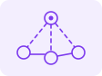

# Kudzayi Chimbodza

**AI Engineer · Agentic AI · RAG & LLM evaluation · IoT · Cloud**

I build AI systems that show their sources and get measured, not just demoed. M.S. Cyber-Physical Systems (IoT), Northeastern University, Dec 2026 (GPA 4.0) · CCNA · Ontario, Canada.

**Keywords:** `Agentic AI` `LangGraph` `MCP` `RAG` `LLM evaluation` `Guardrails` `Claude API` `Local LLMs` `Python` `PyTorch` `Computer vision` `IoT` `ESP32` `AWS` `Kubernetes` `Terraform` `CI/CD`

---

## Featured projects

<table>
<tr>
<td width="50%" valign="top">

**[Agentic Researcher](https://github.com/kchimbodza/agentic-researcher)**\
Multi-agent research assistant: plans lookups, checks every quote against the PDF page, asks a human to sign off.

**Claude Haiku 60% → 95% on 21 test questions for about $0.08 a run · 0 made-up answers · 12/12 prompt-injection attacks blocked · held-out set included**

`LangGraph` `MCP` `Agent evals` `Guardrails` `Human-in-the-loop` `LoRA`
</td>
<td width="50%" valign="top">

**[Datasheet Answer Finder](https://github.com/kchimbodza/datasheet-answer-finder)**\
Local RAG: answers hardware-datasheet questions with the exact quote and page number.

**Right page in the top 3 for 73% of test questions · fully offline**

`RAG` `Ollama` `Chroma` `Embeddings` `LLM evaluation`
</td>
</tr>
<tr>
<td width="50%" valign="top">

**[AISS: Accessible AI Surveillance](https://github.com/kchimbodza/aiss-accessible-vision)**\
Turns webcams and old phones into smart CCTV that confirms a person, then texts the owner.

**97% accuracy over 100 field trials**

`Python` `OpenCV` `NanoDet` `Twilio`
</td>
<td width="50%" valign="top">

**SmartScan: Radar Fall Detection** M.S. capstone · private until graded\
Camera-free ceiling sensor that detects falls and alerts family caregivers.

**Firmware to cloud to Android app · demo on request**

`ESP32-S3` `C++` `60 GHz radar` `MQTT` `Firebase` `Android`
</td>
</tr>
<tr>
<td width="50%" valign="top">

**[Infra Topology Generator](https://github.com/kchimbodza/infra-topology-generator)**\
Describe an industrial site in plain English, get a network design checked against IEC 62443.

**Security rules built into the output**

`Python` `Claude API` `IEC 62443` `JSON`
</td>
<td width="50%" valign="top">

**[K-Flix DevOps Pipeline](https://github.com/kchimbodza/k-flix-devops-cicd-pipeline)**\
Every push is tested, scanned and deployed to Kubernetes, with monitoring and Slack alerts.

**GitOps from commit to cluster**

`GitHub Actions` `ArgoCD` `Terraform` `AWS EKS` `Prometheus`
</td>
</tr>
<tr>
<td width="50%" valign="top">

**[Local LLM Benchmarks](https://github.com/kchimbodza/local-llm-benchmarks-arc-b390)**\
Found which open-source models run well fully offline on a 16GB laptop GPU, with a pick for each task.

**Code compiled and run, not just read · tuning raised prompt speed from 33 to 193 tokens/sec**

`llama.cpp` `Vulkan` `Intel Arc` `Local LLMs` `Benchmarking` `Linux`
</td>
<td width="50%" valign="top">

**[Scalable AWS Web Infrastructure](https://github.com/kchimbodza/aws-scalable-webapp-infra)**\
A web stack across 3 availability zones that adds servers when traffic rises, all as code.

**Auto-scaling with CloudWatch alarms**

`Terraform` `VPC` `ALB` `Auto Scaling` `RDS`
</td>
</tr>
</table>

<b>More projects</b> (Kubernetes, IoT, networking, testing, web)

- **[Fraud Detection on Kubernetes](https://github.com/kchimbodza/fintech-fraud-detection)**: a fraud-check API that scales from 1 to 5 copies under load and heals itself on a 3-node k3s cluster (FastAPI, Docker, HPA).
- **[SmartScan Node](https://github.com/kchimbodza/smartscan-node-aws)**: the first SmartScan prototype (ESP32, AWS IoT Core, Lambda, Terraform). Husky Pitch Summit 2025 semi-finalist.
- **[Network API Test Automation](https://github.com/kchimbodza/network-api-test-automation)**: 42 automated tests for a network management API, run on every push.
- **IoT system**: [edge device](https://github.com/kchimbodza/iot-edge-device-simulation) · [gateway to cloud](https://github.com/kchimbodza/iot-gateway-cloud-bridge) · [protocol analysis with Wireshark](https://github.com/kchimbodza/iot-network-protocol-analysis)
- **Networking labs**: [ESXi homelab](https://github.com/kchimbodza/esxi-npi-lab) · [DNS server](https://github.com/kchimbodza/dns-lab-config) · [subnetting plan](https://github.com/kchimbodza/network-subnetting-lab)
- **Web apps**: [K-Flix movie app](https://github.com/kchimbodza/k-flix-react-app) · [Library app](https://github.com/kchimbodza/library-app)
- **[Visual Player](https://github.com/kchimbodza/visualplayer)**: a Linux media player for HDR video and Dolby Atmos.

---

## Experience

| Role | Where | When |
|---|---|---|
| **AI Engineer Co-op** · LLM pipelines where every answer points back to its source | StrataVeda, Toronto | Jun – Aug 2026 |
| **Graduate Teaching Assistant** · IoT & Embedded Systems | Northeastern University, Toronto | Jan – Apr 2026 |
| **IT Product Security Consultant** (volunteer) | Built For Impact, Toronto | Mar – May 2025 |
| **IT Support Analyst** | Creativ Momentum, Harare | 2019 – 2024 |

---

## Toolbox

**AI & LLMs:** `Claude API` `LangGraph` `MCP` `RAG` `Agent evals` `Ollama` `llama.cpp` `Chroma` `PyTorch` `LoRA` `OpenCV` 
**Software:** `Python` `TypeScript` `C++` `Kotlin` `FastAPI` `React` `Node.js` `pytest` 
**Cloud & DevOps:** `AWS` `Terraform` `Docker` `Kubernetes` `GitHub Actions` `ArgoCD` 
**IoT & networks:** `ESP32` `FreeRTOS` `MQTT/TLS` `Firebase` `CCNA` `IEC 62443`
